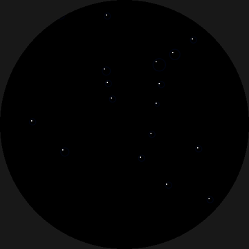

# Compact O2 Analyzer — ESP32-2424S012 + ADS1115 + R-22D

A handheld analyzer shaped like a T: the round display faces up on a puck, and the sensor points forward out of a tube underneath it. Hold the diverter against a cylinder valve and the screen faces you, upright. It's made from **5 printed parts** (bezel, display puck, sensor tube, cap and diverter) and 2 small screws. It's 39.5 mm tall, 86.3 mm long plus the sensor's 4.8 mm threaded nose, or 99.9 mm with the diverter on. The cap unscrews in under one turn to give access to the sensor and the battery.

```
  side view (sensor points right; you look at the screen from the left)

   ┌──────── BEZEL ─────────┐        screws onto the puck's rim, holds the glass
   │  ESP32-2424S012         │        USB-C at the back, power button on the left
   │  ADS1115 bay            │  PUCK
   ├──┴── 2× M2 screws + inserts ┴┤
   │  LiPo pocket   │ plug    ╞══ CAP ══╡ DIVERTER
   └──── TUBE ──────┴─space───┘   sensor     DIN cone / yoke face
                        4-start spigot
```

## Files
| File | What |
|---|---|
| `o2_analyzer.scad` | Fully parametric model (OpenSCAD). Every dimension is at the top. |
| `stl/body.stl` | Display puck. Print rim-up (flat bottom on the plate), no supports. |
| `stl/tube.stl` | Sensor tube. Print standing on its spigot, as exported, no supports. |
| `stl/cap.stl` | Cap. The sensor sits on its floor. Print open-end up, as exported, no supports (the taper is under 45°). |
| `diverter.scad` → `stl/diverter.stl` | Screw-on diverter. It also holds the sensor in. Print nose-down, no supports. |
| `stl/bezel.stl` | Screw-on display bezel. Already flipped face-down for printing. |
| `stl/fit_test.3mf` | **Print this first.** One object per piece, so you can untick the ones you don't need in Bambu Studio or PrusaSlicer: display seat ring (with the switch and SH-plug notches), sensor seat (the cap floor with its O-ring hole, plus the body bore), flange ring, and a 4 mm pair of the tube/cap thread (male and female). The same pieces are in `stl/fit_test/` as separate STLs, and all together in `stl/fit_test.stl`. Regenerate them with `python3 tools/fit_test_3mf.py`. |
| `step/*.step` | The same parts as STEP solids for Fusion 360 or SolidWorks (see CAD files below). |
| `firmware/O2_Analyzer/O2_Analyzer.ino` | Arduino sketch. |

## ⚠️ Measure before you print
The sensor profile is measured from a real PSR-11-39-MD:
- 40.5 mm overall.
- A 6.59 mm threaded nose, with the O-ring at its base (1.7 mm thick, 18.0 mm across when fitted).
- A Ø26 × 15.75 mm body.
- A Ø28.5 × 8.5 mm flange. AII's drawing says Ø29.3 (1.154"), so other makes may differ.

Other R-22D-type sensors may differ slightly, so check them against yours. Only the rear taper and boss (marked `*`) are still estimates. `s_nose_h` and the O-ring size set how much thread the diverter grips, so they matter most. If you change the nose values or `cap_floor_t`, change them in `diverter.scad` too.
- `plug_clear` — the space behind the sensor for the Molex plug and its wire bend (11 mm).
- `pcb_d`, `pcb_tab_w`, `pcb_tab_r`: the board outline, a 37 mm circle plus a 14.23 mm tab at the USB-C end, 38.5 mm overall, from the board's spec drawing. The board has a factory **42 mm cover glass** (1.75 mm thick, bevelled to 0.5 mm over its outer 2 mm, underside 3.3 mm above the back of the board) that overhangs the board. It sits in a 42.6 mm pocket at the top of the body (`cover_d`, `cover_t`, `cover_under`), which is why the rim and bezel are wider than the rest of the body. The on/off switch sticks out about 0.4 mm past the board edge (`sw_protrude`) and has its own channel down the rim.
- `glass_d`, `glass_stack`, `comp_h` — display glass diameter, glass-to-PCB height, and the tallest component under the PCB.
- `usb_off`: the USB-C connector sits 2.6 mm left of the tab's centre with the display facing you (−2.6).
- `usb_angle`, `btn_angle`, `btn_z_off`, `btn_reach`: where the USB-C port and the on/off switch sit, and how far in the button nub reaches. Angles are measured looking at the display side: 0° is right, 270° is the USB-C end, and 180° puts the switch on the left.
- `pad_angles`: where the three board support pads go. Check that the back of your board has no parts at its edge at 30°, 150° and 297°.
- `sh_angle`: where the board's 4-pin SH connector is (315°, test-fitted). The SH plug's slot and wire pocket follow it.
- `batt_*` — the battery size. The default is a 602030 (nominally 6×20×30 mm, ≈300 mAh; the pocket is sized for a measured 5.96 × 20.01 × 31.01 mm cell). It lies flat in the tube and slides out through the plug space and the spigot, which pass up to about 21 × 8 mm.
- `ads_zone` — 3.8 mm for the ADS1115 with its wires soldered flat. Raise it if your wiring stands taller.

Export a part with: `openscad -D 'PART="body"' -o body.stl o2_analyzer.scad` (also `tube`, `cap`, `bezel`, `fit_test`, `assembly`, `exploded`, `section`). Export the diverter with `openscad -o diverter.stl diverter.scad`.

Print in PETG or ASA with 0.2 mm layers and 4 perimeters, because the threads need them. The tube/cap thread is M31, 4-start: 2 mm between ridges, 8 mm advance per turn, and 0.4 mm clearance. The sensor's flange passes through it, so the sensor still drops into the cap from the back.

The puck and the tube are separate prints so that both threads print upright: the puck rim-up, the tube spigot-down. The tube's thread therefore starts on the build plate. Turn on your slicer's **elephant foot compensation** (about 0.15 mm in Bambu Studio). Otherwise the first layers swell and the cap won't start. The spigot also has a 2 mm lead-in chamfer and thread relief at both ends to help.

**Tuning after a test print:**
| Feature | Parameter | Too stiff | Too loose |
|---|---|---|---|
| Tube/cap thread | `th_clear` (0.40) | 0.5 | 0.3 |
| Battery pocket | `batt_clear` (0.4) | 0.6 | 0.3 |
| Heat-set insert holes | `insert_hole_d` (2.5) | — | use your inserts' recommended hole size |
| Display board in the body | `disp_clear` (0.5) | 0.7 | 0.3 |
| Board's USB-C tab in the body | `tab_clear` (0.7) | 0.9 | 0.5 |
| Sensor fit in the cap | `body_clear` (0.5) / `flange_clear` (0.4) | +0.2 | −0.2 |
| O-ring seal in the cap floor | `oring_squeeze` (0.2) | 0.15 | 0.25 |
| Bezel thread | `bz_clear` (0.30) | 0.4 | 0.2 |
| Display glass loose under the tightened bezel | `seat_lift` (0.45) | lower it if the bezel won't seat | raise it by the gap you measure from the glass to the rim top |
| Power button travel | `btn_reach` (18.8) | raise it (e.g. 19.0) if the button presses itself or the board sits on it | lower it (e.g. 18.6) if you still have to push too far |

## Bill of materials
- ESP32-2424S012 (C or N version), taken out of its stock case
- ADS1115 breakout (Adafruit or clone), **without** pin headers
- R-22D type sensor with a 3-pin Molex: PSR-11-39-MD, AST-22D, or Divesoft R-22S
- A Molex mating pigtail for the sensor (sold as an "R-22 sensor cable" or a Molex KK 2.54 3-pin housing). Silicone-insulated wire is best, because it flexes the most as the cap turns.
- A 1S LiPo, 602030 or similar, with a JST-1.25 2-pin plug
- A short JST-1.25 2-pin extension (male/female). Its battery-side plug sits in the plug space in the tube, so you can swap the battery without opening the puck.
- 2× M2 heat-set inserts (3 mm long, 3.0 mm across) and 2× M2×4 pan-head screws, to join the puck and the tube. If you'd rather skip the inserts, set `use_inserts = false` and use 2× M2×6 self-tapping screws instead.
- A 4-pin JST-SH 1.0 mm pigtail (pre-crimped plug with short wires) for the board's I2C/UART connector. The puck has a slot and a wire pocket for the plugged-in cable, so the board unplugs from the ADS1115 without soldering. The pocket is sized for a plug 7 × 3 mm whose back sits 1.8 mm past the board edge (`sh_plug_*`); soldering wires straight to the connector's pins still works too.
- Optional: 2× 100 kΩ resistors and a 100 nF capacitor for the battery gauge

## Wiring
| From | To | Notes |
|---|---|---|
| Board SH-connector pin **3V3** | ADS1115 VDD | Through the SH pigtail; check its wire colours against the board's pin labels |
| Board SH-connector pin **GND** | ADS1115 GND **and** ADDR | ADDR to GND sets I2C address 0x48 |
| Board SH-connector pin **RX (GPIO20)** | ADS1115 SDA | The C3 lets you route I2C to any pin. The breakout already has pull-ups. |
| Board SH-connector pin **TX (GPIO21)** | ADS1115 SCL | |
| Sensor **+** | ADS1115 A0 | |
| Sensor **−** | ADS1115 A1 **and** GND | Grounding the − lead gives the cell a reference so it doesn't float |
| Battery + → 100k → A2 → 100k → GND | ADS1115 A2 | Optional battery gauge. Put 100 nF across the lower resistor. Set `BATT_DIVIDER 0` in the sketch if you skip it. |
| Battery JST | Extension | Extension → board's JST-1.25 BAT port |

**Sensor polarity:** pinouts differ between brands. With a multimeter in air, find the pin pair that reads +8 to +14 mV. The red probe is on **+**, and the third pin is unused.

The board's side button drives its IP5306 power chip:
- **On:** a short press.
- **Off:** hold the button for about **10 seconds**, until the screen goes dark. This is a true off: the power chip disconnects the board, so a charged battery keeps for months in storage.

The IP5306 on these boards appears to be a factory-configured variant that doesn't behave like the datasheet describes: a double-press doesn't turn it off, it doesn't switch itself off at light load, and it isn't reachable over I2C, so the firmware can't power the board down.

USB-C charges the battery and programs the board. While USB is plugged in, the board stays powered.

## Assembly
1. **Join the puck and the tube.** Press the two heat-set inserts into the holes in the tube's flat top with a soldering iron (about 220 °C for PETG). Push them in flush or a little below the surface, never proud of it, or the puck won't sit flat. If one ends up proud, file it flush. Then set the puck's flat bottom on the tube's flat top, with the puck's USB-C slot over the tube's back end and the two wire holes lined up, and drive the 2× M2×4 screws down through the puck floor into the inserts. Do this first, while the puck is empty.
2. Solder the wires to the ADS1115. Leave the sensor and battery leads long, and feed them down through the two wire holes into the tube's plug space, then out through the spigot. Leave the sensor leads about 3 cm longer than the straight run: the cap turns a little under one turn, and that slack takes up the twist. Fix the ADS1115 to the puck floor with double-sided foam tape, long side front to back, clear of the screw heads.
3. Plug the SH pigtail into the board's 4-pin connector, at the lower right with the display facing you, and solder its other end to the ADS1115. Plug the battery extension into the board. Drop the board in, display up, with the SH plug lined up with its slot in the seat (it then sits over a small pocket where its wires bend down), so it rests on the three support pads with the USB-C lined up with its slot at the back. The 42 mm cover glass settles into the pocket at the top, level with the rim. The on/off switch, on the board's left edge, lines up with the flexible tab in the wall.
4. Screw the bezel onto the rim clockwise, about three-quarters of a turn, until it seats firmly on the rim's top edge. Snug by hand is enough.
5. Plug the battery into the extension, then slide the battery into the tube through the spigot, lying flat with its leads at the front end, until it drops past the small lip at the front of its pocket. Tuck the extension's plug into the plug space. To take the battery out, lift its front end over the lip and slide it out; a loop of tape stuck to its front end makes a handy pull tab.
6. Plug the Molex into the back of the sensor. Drop the sensor nose-first into the cap so its shoulder sits on the floor and the O-ring presses into the floor hole. The threaded nose sticks out the front.
7. Screw the cap onto the tube's spigot. It takes a little under one turn.
8. Screw the diverter onto the sensor nose until it's snug against the cap floor. Hand-tight is enough. It works like a nut: the cap floor is clamped between the sensor's shoulder and the diverter, so pressing the analyzer against a valve can't push the sensor back.

To change the sensor, unscrew the diverter and the cap, then lift the sensor out.

**Power button:** press the flat recess on the left side of the puck. The tab flexes inward and its nub presses the board's button.

## Firmware
Install the **GFX Library for Arduino** (moononournation) and **Adafruit ADS1X15** libraries. Choose the board **ESP32C3 Dev Module** and set *USB CDC On Boot* to Enabled.

### Startup animation


At power-on, the Dark Water Diving logo fades in and holds for about 3 s, then cross-fades into the animation: bubbles rise and two oxygen atoms drift together and bond. The pair bursts into the gauge ring, and the initials are then traced in light, followed by the title and a dedication line. The whole intro lasts about 8 s; tap the screen to skip it. To personalise it, edit the defines above `drawBootFrame()` in the sketch:
- `BOOT_INITIALS` takes 1–5 letters or digits (default `"FSS"`).
- `BOOT_TITLE` is the title line.
- `BOOT_LINE` is the small line under the title (`""` hides it).
- `BOOT_MS` sets the length of the animation.
- `LOGO_MS`, `LOGO_IN_MS` and `LOGO_XFADE_MS` set how long the logo shows, its fade-in, and the cross-fade.

To change the logo, replace `firmware/assets/boot_logo.png` (any size, ideally square; transparent areas become black) and run `python3 firmware/tools/png2rgb565.py firmware/assets/boot_logo.png`. This regenerates `firmware/O2_Analyzer/boot_logo.h` for the sketch and `simulator/boot_logo.png` for the simulator. Pass `--diameter` to change its size on the 240 px display (default 232, which keeps the edge clear of the bezel).

The simulator plays the same animation, so you can preview a change there first; change the constants at the top of its boot-animation block to match.

The display shows:
- the O2 % in large seven-segment digits
- an arc gauge around the rim
- MOD in feet at PO2 1.4 and 1.6
- battery %
- a STABLE / SETTLING status (STABLE means readings have stayed within 0.15 % for 2 s)
- warnings for a weak or missing sensor

The controls are:
- **Long-press** on the main page to calibrate to 20.9 % air.
- **Tap** to switch to the detail page (raw mV and calibration values).
- On the serial console, `c` calibrates to air, `o` calibrates to 100 % O2 (optional second point), and `r` resets calibration.

Calibration is saved in flash. Recalibrate before each use, as you would with any analyzer.

In the T body the USB-C faces you and the sensor points away. If the text isn't upright that way, change `DISPLAY_ROTATION` (0–3, quarter turns) at the top of the sketch.

The pin map at the top of the sketch is the commonly published one for this board. If the screen stays dark, check `PIN_TFT_*` first.

## Diverter: analyzing a cylinder
The diverter screws onto the sensor's M16×1 nose. Its thread starts right at its rear face, so it grips all of the exposed thread, about 5 turns. The sensor's O-ring seals in the cap floor, which keeps gas away from the electronics even with the diverter off, and the diverter's rear face tightens flat against the floor.

Gas enters through a Ø1.6 mm restrictor in the nose, passes through a small chamber over the sensor face, and exits through 6 side vents. The vents have 11–14× the inlet's area, so the sensor stays at roughly ambient pressure and the reading isn't pushed high. The vents sit just behind the cone, so they stay outside the valve.

**Fit:**
- **Yoke (A-clamp) valve:** press the flat Ø18 mm face onto the valve's outlet O-ring.
- **DIN valve:** the cone seats in the mouth of the DIN socket.

**Steps:**
1. Calibrate in air first. With the diverter on, air reaches the sensor through the vents by diffusion, so give it about a minute to settle. Or calibrate with the diverter off, which responds in seconds, but screw it back on before you measure, because it's what holds the sensor in. Wait for STABLE, then long-press to calibrate.
2. Hold the analyzer firmly against the valve outlet, then crack the valve **just** enough to hear a gentle hiss. You want roughly 1–2 L/min; the sensor is rated for 0.5–2 SCFH. Don't open it further.
3. Wait for STABLE (about 10–20 s), then read the value.
4. Close the valve **before** pulling the analyzer away.
5. Point the vents away from your face, and never use it on a fully open valve.

A higher flow doesn't give a more accurate reading. It builds pressure at the sensor face and reads high. If the reading creeps up as you open the valve more, you're over-flowing.

If the flow is hard to control on your valves, change the inlet with `inlet_d` in `diverter.scad`. Use about 1.2 for a gentler flow, or 2.0 if the reading responds too slowly.

## CAD files (STEP) for Fusion 360, SolidWorks, Onshape

> **Out of date:** the STEP files and `cad/o2_analyzer_cq.py` were made from an earlier, straight (non-T) version, before the sensor was measured, before the screw-on bezel, and before the cap floor that the diverter clamps. They need regenerating before you use them for anything dimensional. The STLs in `stl/` are current.
The `step/` folder has every printed part as a true solid, with exact cylinders, faces and fully modeled threads. Open them with **File → Open** in Fusion 360 or SolidWorks. You can sketch on faces, fillet, cut and measure, then save in that program's own format.

| File | Part | Origin (z = 0) |
|---|---|---|
| `step/body.step` | Body | spigot end |
| `step/bezel.step` | Bezel | lower edge of the skirt |
| `step/cap_open.step` | Open cap | cap floor |
| `step/cap_diverter.step` | Cap with built-in diverter | nose face |
| `step/diverter.step` | Screw-on diverter | nose face |
| `step/o2_analyzer_assembly.step` | Everything assembled (open cap + diverter), with stand-ins for the sensor, display, ADS1115 and battery | — |

Parts are in their assembled orientation, not their print orientation. For printing, use the STLs in `stl/`, or flip the bezel and the built-in cap nose-down in your slicer.

A STEP file has no feature history, so you edit the solid directly (Fusion's Press/Pull, SolidWorks' Move Face). For parametric changes, edit `cad/o2_analyzer_cq.py`, which is a CadQuery port of the SCAD model with the same parameter names, and regenerate everything with:

```
pip install cadquery
python3 cad/o2_analyzer_cq.py          # or: python3 cad/o2_analyzer_cq.py body cap_open
```

Each STEP part matches its OpenSCAD STL to within 0.7% of volume and has identical outer dimensions. Keep the two sources in sync if you change parameters.

## Opening in VS Code
1. Clone this repo (VS Code: **Git: Clone**), or unzip the project somewhere permanent.
2. Open the folder in VS Code with **File → Open Folder…**.
3. Install the two recommended extensions when VS Code prompts you: **PlatformIO IDE** and **OpenSCAD**.
4. **Firmware:** PlatformIO detects `firmware/platformio.ini`. The first build downloads the ESP32 toolchain and both libraries, which takes a few minutes. Then use the PlatformIO toolbar at the bottom of the window:
   - ✓ builds the firmware.
   - → uploads it to the board.
   - 🔌 opens the serial monitor at 115200 baud.

   If the upload doesn't connect, hold the board's BOOT button while you plug in USB-C.
5. **Enclosure:** open any `.scad` file and click *Preview in OpenSCAD*. This needs the OpenSCAD app installed, from openscad.org. After you change parameters, export the STLs from OpenSCAD.
